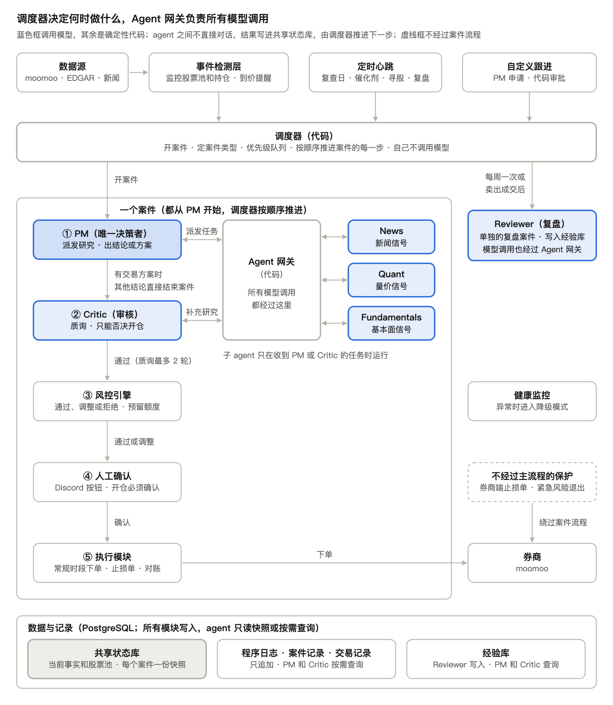

# AI Agent 美股交易系统需求 Proposal

Sep 29, 2026 · @Eric Xi

## 目录

1. [架构](#架构)
   - [触发](#触发)
   - [调度器](#调度器)
   - [决策层：PM 与子 agent](#决策层pm-与子-agent)
   - [审核层：Critic](#审核层critic)
   - [风控与执行](#风控与执行)
   - [记录、复盘与经验](#记录复盘与经验)
   - [支撑模块](#支撑模块)
   - [不经过主流程的保护](#不经过主流程的保护)
2. [触发](#触发-1)
   - [1. 事件驱动](#1-事件驱动)
   - [2. 定时心跳](#2-定时心跳)
   - [3. 自定义跟进](#3-自定义跟进)
   - [通用规则](#通用规则)
3. [股票池与寻股](#股票池与寻股)
4. [调度器与运行模块](#调度器与运行模块)
5. [Task / Result 通信](#task--result-通信)
6. [Agent](#agent)
7. [共享状态库](#共享状态库)
8. [共享上下文](#共享上下文)
9. [持仓与退出](#持仓与退出)
10. [风控引擎与执行](#风控引擎与执行)
11. [订单生命周期](#订单生命周期)
12. [故障处理](#故障处理)
13. [记录、复盘与经验](#记录复盘与经验-1)
    - [程序日志](#程序日志)
    - [案件记录](#案件记录)
    - [交易记录](#交易记录)
    - [状态库](#状态库)
    - [经验库](#经验库)
    - [查询工具](#查询工具)
    - [复盘](#复盘)
14. [技术栈与部署](#技术栈与部署)

以代码调度器（Orchestrator）为核心的多 agent 美股交易程序，决策层以 PM 为中心。只有出现值得关注的事件、定时心跳到期或自定义跟进到点时才开案件；调度器唤醒 PM，PM 通过 Agent 网关向 News、Quant、Fundamentals 派发任务；决策层之外的 Critic 审核 PM 的方案，可要求回应或补充研究；方案必须通过代码风控引擎，再经人工确认或执行。agent 之间只通过 Task / Result 协作，事实统一存放在共享状态库，所有行为写入日志，用于评估每个 agent 是否贡献 alpha。

## 架构

源文件：[Proposal图.svg](Proposal图.svg)，改图后用它重新导出 PNG。

系统由运行层（全部是代码）、决策层（PM 和子 agent）、审核层（Critic）、风控与执行、记录与复盘五部分组成，另有共享状态库和健康监控两个支撑模块。记录分程序日志、案件记录、交易记录和状态库（即共享状态库）四部分，复盘结果写入经验库。只有决策层和审核层调用模型，其余全部是确定性代码。一个案件从上到下依次经过以下环节。

### 触发

- **数据源**：moomoo 实时行情推送、SEC EDGAR 公告和财报原文、新闻，见「技术栈与部署」
- **事件检测层**（代码）：只监控股票池和持仓中的股票；阈值和规则可配置；给每个事件标注类型、强度和来源。未达阈值的事件只写日志，不进入队列，也不会唤醒任何模型
- **定时心跳**（代码）：每个交易日收盘检查 PM 写下的日期（持仓复查日、催化剂截止日期、关注复查日），以及是否有新候选、股票池候选是否不足；只有事项到期才开案件
- **自定义跟进**：PM 针对具体原因在结论中申请、问题由 PM 自己写的一次性检查，调度器审批
- 所有达到条件的事件、到期的心跳和获批的跟进都进入调度器队列

### 调度器

- 开案件时按「驱动方式 × 股票状态」确定案件类型，类型固定 PM 要回答的问题、允许的结论、最低研究要求和排队优先级
- 按优先级从队列取出：持仓风险事件 > 持仓其他事件 > 持仓的心跳和跟进 > 关注股事件 > 关注股的心跳和跟进 > 候选股事件 > 候选评估 > 寻股 > 复盘
- 每个触发各自开一个案件，不合并；同一只股票同一时间只跑一个案件，其余案件排队依次运行
- 为案件生成共享状态库的固定快照，并推进案件阶段：唤醒 PM → 等待结论 → 唤醒 Critic → 交给风控引擎 → 人工确认 → 执行
- 调度器只负责「什么时候做什么」：不调用模型、不转发任务内容、不做交易判断、不下单

### 决策层：PM 与子 agent

- **PM** 是唯一的决策者，使用单个模型（主模型不可用时自动换备用模型，见「Agent」）。收到案件后，用 `dispatch_tasks` 派发任务
- **Agent 网关**（代码）拦截任务：检查白名单、任务数、轮次和预算，注入共享上下文，调用对应子 agent，校验输出格式，再把 Result 作为工具结果交回 PM
- **子 agent**：News 解读新闻，Quant 解读代码算好的行情和指标，Fundamentals 解读财报、预期和公告。它们只在收到任务时运行，互相看不到对方的结果，也不能再派任务
- PM 最多派 2 轮任务，然后用 `submit_conclusion` 提交结论，正面回答案件的问题，并附一个和子 agent 信号格式相同的评分。结论只能从案件类型允许的范围里选：无动作、交易方案、论点更新、跟进申请、升降级或股票池增删。开仓方案和升级为关注必须引用至少 2 个不同子 agent 的 Result
- 大多数案件在这一步以「无动作」结束

### 审核层：Critic

- Critic 位于决策层之外，只审核 PM 提出的交易方案，使用与 PM 不同厂商的模型（备用模型也一样）
- 可以通过；提出质询，要求 PM 逐条回应；经 Agent 网关要求补充研究，结果同时交给 PM 和 Critic；或者否决开仓方案
- 质询与回应最多 2 轮，仍有分歧时连同双方意见推送给你决定
- 退出类方案只审 1 轮，Critic 不能否决；有异议时连同双方意见推送给你决定
- 被否决的开仓类方案仍然记录，用于反事实评估

### 风控与执行

- **风控引擎**（代码）：计算单笔风险和组合合计风险，按开仓类或减仓类规则检查，结果为通过、调整或拒绝。一次只处理一个方案，通过后立即预留资金、持仓名额、板块额度和风险额度
- **下单前再校验**：重新读取实时报价、券商持仓和可用资金，再跑一次风控；超出方案有效期或价格偏离过大，方案作废并退回 PM
- **人工确认**：开仓类方案通过 Discord 按钮确认；退出类方案按「持仓与退出」中的退出路径处理
- **交易时段**：只在常规交易时段下单；盘前盘后形成的方案等开盘执行，开盘时由下单前再校验检查跳空
- **执行模块**：用客户端订单 ID 下单，买入成交后按成交数量挂止损单，跟踪订单直到终态；断线或重启后先与券商对账。案件在提交订单后结束，订单由执行模块单独跟踪

### 记录、复盘与经验

- **程序日志**：实时记录所有模块、agent 和人的每个动作，只追加，不可修改；用于排查故障、审计和复现
- **案件记录**：三种驱动触发的所有案件，包括没有调用 agent 的；记录结论、Result、论点变化、事后收益和复盘
- **交易记录**：像银行 App 的交易流水，每笔买入、卖出、止损单一条，带状态、成交价、费用、结算状态和来源案件 ID
- **状态库**：即共享状态库，保持现有设计，见「支撑模块」
- PM 和 Critic 通过只读的 `query_history`、`query_lessons` 按需查询案件记录、交易记录和经验库，不自动注入上下文
- **复盘**：每周由定时心跳触发一次；每笔卖出后复盘一次（止损单自动退出由事件驱动，主动退出成交后自动开始）。复盘结果写入经验库，修改建议推送给你确认

### 支撑模块

- **共享状态库**：存当前市场事实、当前任务状态、已产出的结构化结果三类数据。每类字段只有一个写入者，只追加不覆盖，每个案件使用固定快照。它是所有 agent 读取事实的唯一来源，只存数据，不承担 agent 之间的通信
- **健康监控**：监控模型 API、券商连接、数据延迟、调用预算和调度器心跳，异常时进入降级模式：保留所有止损单、暂停开仓、不执行未经人工确认的模型发起退出，并告警。单个模型不可用时先换备用模型，PM 或 Critic 的主模型和备用模型全部不可用才算模型 API 异常

### 不经过主流程的保护

- **券商端止损单**：价格触及止损价即由券商执行，与程序是否在线无关，但不保证成交价；只在常规交易时段触发，盘前盘后的价格变动要等开盘才处理
- **紧急风险退出**：由代码规则触发，只能减仓或清仓，不排队，可中止正在运行的案件，执行后立即通知你。单只股票的紧急阈值由 PM 在方案中设定，风控检查它在配置范围内，没写时用默认值

## 触发

三类驱动只负责决定"要不要开案件"，判断全部由代码完成。模型只在案件开出之后才被叫醒。

开案件时，调度器按"驱动方式 × 股票状态"确定**案件类型**。每种类型固定四件事：PM 要回答的问题、允许提交的结论、最低研究要求、排队优先级。

| 驱动 | 由谁触发 | 时间尺度 | 用途 |
| --- | --- | --- | --- |
| 事件驱动 | 事件检测层（代码） | 实时 | 对外部变化做出反应 |
| 定时心跳 | 调度器时钟（代码），读取 PM 写下的日期 | 每日收盘检查；复查间隔 3 到 20 个交易日 | 系统规定的例行检查，问题固定：定期检查论点、维护股票池 |
| 自定义跟进 | PM 申请，调度器审批 | 不限，由 PM 指定触发时间 | 针对某个具体原因的一次性检查，问题由 PM 自己写 |

驱动方式决定要回答的问题；允许的结论只由股票状态决定。同一只股票不论是事件、定时心跳还是自定义跟进开出的案件，能做的事情都一样：

| 股票状态 | 允许的结论 |
| --- | --- |
| 持仓 | 持有、加仓、减仓、清仓、更新论点、申请跟进 |
| 关注 | 开仓方案、无动作（继续关注）、更新关注论点、降为候选、移出、申请跟进 |
| 候选 | 升级、保持、移出 |

复查类案件（持仓复查、关注复查）里选择持有或继续关注，就是续期，必须设下一个复查日；催化剂截止日期到期后选择持有或继续关注，还要写新的催化剂和截止日期。寻股不针对单只股票，只能增删股票池。复盘案件由 Reviewer 处理，不唤醒 PM，只产出复盘结果，见「复盘」。

### 1. 事件驱动

**监控范围**：只监控股票池（候选、关注）和持仓，池子外的股票不监控。

**事件来源**（全部由代码判断，阈值可配置）：
- 价格和成交量异动。候选股的阈值更高，只有大事件才开案件
- 新闻和公告：按来源、关键词和强度初筛
- 财报发布：按财报日历
- 关注股的入场条件满足：PM 在关注论点里写下的、代码能检测的条件
- 持仓达到目标价，或证伪条件中代码能检测的部分触发：PM 在投资论点里写下的条件
- 到价提醒：PM 写下的价格类条件（关注股入场价、持仓目标价、证伪价位等）由代码设置成 moomoo 到价提醒，触发后 moomoo 推送，作为事件进入事件检测层
- 止损单成交：开复盘案件，见「复盘」
- 未达阈值的事件只写入程序日志，不开案件

**到价提醒的维护**（由代码执行）：到价提醒只覆盖价格、涨跌幅、成交量这类条件，技术指标等其他条件仍由事件检测层自己计算。论点更新或股票状态变化时，代码同步增删对应的提醒。程序要收到推送，OpenD 必须在线；断线恢复后，事件检测层用实时行情把这些条件补查一遍。

**持仓风险事件与紧急风险事件**：持仓出现风险级别的价格异动或负面事件（由事件检测层按规则标注，比如盘中跌幅、负面新闻强度超过风险阈值），但还没触及紧急阈值，属于持仓风险事件，开案件交给 PM 判断，排队优先级最高。触及 PM 设的紧急阈值或组合熔断线，属于紧急风险事件，由代码直接走紧急风险退出，不开案件。

| 股票状态 | 目标 |
| --- | --- |
| 持仓 | 这个事件是否削弱或推翻了论点？ |
| 关注 | 入场机会是否出现？ |
| 候选 | 是否值得升级为关注？ |

### 2. 定时心跳

**心跳本身是纯代码**：每个交易日收盘检查一次，不调用模型。只有检查发现事项到期，才开案件。

**PM 负责写下的日期：**
- **持仓复查日**：每只持仓单独设定。PM 在买入时写进论点，续期时设下一个复查日，也可以在这只股票的任何案件里调整。没写就用默认值 5 个交易日。上下限为 3 到 20 个交易日，可以在配置里改。提前随时可以；往后推需要写理由，且不能超过上限。持仓亏损超过一定幅度时，复查日只能提前，不能推后
- **催化剂截止日期**：每份论点都必须有。有固定日期的事件，比如财报、发布会，截止日期设为事件后一两天；没有固定日期的，PM 必须自己定一个日期。它和复查日各自独立，哪个先到就先查。每个催化剂写成结构化字段：描述、截止日期和引用的对象。有固定日期的必须引用日程项（如财报日历条目）；没有固定日期的，在事件案件里判定它已经发生时，由 PM 把对应的事件 ID 关联到这个催化剂上。代码靠这些引用判断自定义跟进是否绑定了催化剂
- **关注复查日**：写在关注论点里，规则和持仓复查日相同。关注论点同样有催化剂截止日期，到期开关注复查案件；未兑现视为关注论点削弱

| 检查项 | 开出的案件 | 目标 |
| --- | --- | --- |
| 持仓复查日到期 | 持仓复查 | 论点是否仍然成立？ |
| 投资论点的催化剂截止日期到期 | 持仓复查 | 催化剂兑现了吗？论点是否仍然成立？ |
| 关注复查日到期 | 关注复查 | 是否还值得关注？ |
| 关注论点的催化剂截止日期到期 | 关注复查 | 催化剂兑现了吗？是否还值得关注？ |
| 有新候选 | 候选评估 | 是否升级？ |
| 股票池候选不足 | 寻股 | 补充哪些候选？ |
| 每周固定时间（默认每周最后一个交易日收盘后） | 每周复盘 | 这一周的决策和交易哪里对、哪里错？ |

允许的结论按股票状态确定，见本节开头的表。

**候选评估的上限**：每天开出的候选评估案件有上限，按最新评分从高到低开，其余顺延到下一个交易日，避免寻股一次加入多只候选后集中消耗预算。

**代码直接完成、不开案件的事**：候选超期移出、与券商全量对账、评估窗口到期后计算收益（结果汇总进每周复盘）。

**每周复盘**：由 Reviewer 处理，不唤醒 PM、不产生交易，见「复盘」。

**故障处理**：如果复查到期，但因为系统故障没有得出结论，事项顺延，不当作"不续期"。

### 3. 自定义跟进

**和定时心跳的区别**：不按时间长短区分，按用途区分。

- **定时心跳**：系统规定的例行检查，问题是固定的，比如"论点是否仍然成立""催化剂兑现了吗"
- **自定义跟进**：PM 针对某个具体原因提出的一次性检查，问题由 PM 自己写

**允许的例子：**
- "刚公布大单，3 小时后看盘中反应"
- "竞争对手 11 月 18 日发财报，之后看对这只股票的影响"
- "12 月的行业大会可能发布新产品，会后看市场反应"（前提是这不是论点里的催化剂）

**不允许的例子**："两周后再看看论点"。这属于例行复查，应该去调整复查日。

**申请必须写明四项：**
- **原因**：从固定类型中选择，比如事件后反应、外部日程、价格或指标观察，并且必须引用一个具体对象，比如事件 ID、日程项、价格或指标条件
- **要回答的问题**
- **可能采取的动作**
- **触发时间**

**防止重复的规则（由代码执行）：**

| 情况 | 处理 |
| --- | --- |
| 原因没有引用具体对象 | 拒绝，并提示 PM 改为调整复查日 |
| 引用的日程项或事件 ID，就是论点里某个催化剂引用的对象 | 拒绝，因为催化剂截止日期已经覆盖了它 |
| 同一只股票已有原因相同的待执行跟进（原因类型相同，且引用同一个对象） | 用新申请替换旧的，问题、可能的动作和触发时间以新申请为准 |

**其他规则：**
- 股票状态发生变化时，比如清仓、降级或移出股票池，尚未执行的跟进自动作废
- 每只股票同时最多有 2 个待执行的跟进
- 触发时间最远不超过 60 个交易日（可在配置里改），超出直接拒绝
- 跟进案件本身不能再申请跟进
- 每天的申请次数有上限，计入调用预算
- 待执行的跟进会显示在这只股票的案件上下文里，PM 做定时复查时能看到还有哪些问题在排队

**跟进案件**：目标就是申请时写下的问题，允许的结论和这只股票当前状态允许的结论一致。案件上下文会带上原案件的结论和申请原因。

### 通用规则

- **排队优先级**：持仓风险事件 > 持仓其他事件 > 持仓的心跳和跟进 > 关注股事件 > 关注股的心跳和跟进 > 候选股事件 > 候选评估 > 寻股 > 复盘
- **必须正面回答问题**：每个案件都要回答自己的问题；结论是"无动作"时也要说明理由
- **研究要求**：提开仓方案或升级时，必须引用至少 2 个不同子 agent 的 Result
- **升级为关注**：必须写完整的关注论点，包括看好理由、代码能检测的入场条件、催化剂及截止日期、证伪条件和复查日。代码会校验字段是否齐全，以及关注名额是否超上限。升级不经过 Critic
- **交易方案的后续流程**：所有交易方案都要经过 Critic、风控引擎、下单前再校验，以及人工确认或退出路径规则
- **分类型评估**：结论按案件类型分别统计和评估

## 股票池与寻股

股票池是系统关注范围的唯一来源：事件检测层只监控池内股票和持仓，PM 探索的结果也只进入股票池，不能直接下单。

| 字段 | 说明 |
| --- | --- |
| 状态 | 候选、关注、持仓 |
| 来源 | PM 探索或手动添加 |
| 理由与论点草稿 | 加入时由 PM 填写 |
| 板块 | 加入时由代码从数据源写入，交易方案和持仓的板块都取这里，PM 不填；用哪套板块分类跟数据源一起定 |
| 关注论点 | 升级为关注时由 PM 填写：看好理由、代码能检测的入场条件、催化剂及截止日期、证伪条件、复查日 |
| 最新评分 | PM 最近一次结论中的评分 |
| 时间 | 加入日期、上次复查时间、过期时间 |

**增删规则（代码强制执行）：**

- PM 可以添加和删除；添加前代码校验股票代码存在、流动性达标、在允许交易的范围内（纽交所、纳斯达克上市的普通股，含 ADR；不含 ETF、OTC 和杠杆产品；可配置）
- 增删都要写理由；持仓中的股票不能删除
- 删除后一段时间内不能重新加入
- 池子有容量上限，关注名额单独有上限，每天增删次数有上限
- 升级为关注时，代码校验关注论点字段齐全、关注名额未超上限；升级不经过 Critic
- 候选超过期限仍未升级为「关注」，由代码自动移出；PM 选择「保持」时重置过期时间

**寻股触发**（定时心跳的检查项，代码检查，不调用模型；每个交易日收盘检查一次）：

- 有效候选数量低于下限
- 评分 ≥ 1 的候选少于设定数量
- 多数候选临近过期时间

两次寻股之间有冷却期（如 3 个交易日），并使用单独的调用预算，防止市场上确实没有好股票时反复触发。

**寻股流程：** 代码从更大的股票范围按量化条件（相对强度、趋势中回调、盈利预期上调、成交量异常等）粗筛出前 N 只 → PM 以探索模式挑选，可通过 Agent 网关向 Quant 或 Fundamentals 派发任务 → 通过校验的股票以「候选」状态加入股票池。探索模式只判断是否值得研究（加入候选），不判断是否升级为关注，也不给买卖建议；是否升级由之后的候选评估案件决定。

## 调度器与运行模块

运行层由几个职责单一的代码模块组成，都不调用模型做判断。第一版放在同一个 Python 进程里，按模块划分边界，以后需要时再拆开部署。

| 模块 | 职责 |
| --- | --- |
| 调度器 | 队列和优先级、确定案件类型、案件状态机（推进到哪一步）、定时心跳、跟进审批 |
| Agent 网关 | 接收 Task，检查白名单、任务数、轮次和预算，注入共享上下文，调用模型（主模型不可用时切换备用模型），校验输出格式，返回 Result |
| 健康监控 | 监控模型 API（含每个模型的可用状态）、券商连接、数据延迟、调用预算和调度器心跳，决定是否进入降级模式 |
| 风控引擎 | 见「风控引擎与执行」 |
| 执行模块 | 见「订单生命周期」 |
| 程序日志 | 所有模块实时写入，不归任何模块管理 |

调度器只负责「什么时候做什么」：不调用模型、不转发任务内容、不做交易判断、不下单、不做风控检查。每次触发由调度器开一个「案件」并推进阶段，状态写入共享状态库。

**案件流程：**

1. **唤醒 PM**：调度器把案件类型（要回答的问题和允许的结论）、事件、案件上下文和共享事实交给 PM。定时心跳和自定义跟进开出的案件同样从 PM 开始
2. **PM 派发任务**：PM 判断需要哪些信息，通过 Agent 网关向 News、Quant、Fundamentals 派发 Task，可并行派发多个
3. **PM 出结论**：收齐 Result 后，在案件类型允许的范围内给出结论并正面回答问题：无动作（案件结束，需说明理由）、交易方案、论点更新、跟进申请、升降级或股票池增删。判定论点推翻时提出清仓方案，走模型建议退出路径
4. **Critic 质询**：仅针对交易方案；退出类方案只做 1 轮快速审核。Critic 可以通过、提出质询要求 PM 逐条回应、要求补充研究（通过 Agent 网关向子 agent 派发 Task，结果同时交给 PM 和 Critic），或否决开仓方案
5. **PM 回应**：逐条回应质询，可维持、修改或撤回方案。质询与回应最多 2 轮；2 轮后仍未通过，方案连同双方意见推送给人决定。开仓类方案被 Critic 否决时案件结束，方案记入日志；退出类方案 Critic 不能否决，有异议时连同双方意见推送给人决定
6. **风控引擎 → 人工确认 → 执行**，案件结束

**运行约束：**

- 并发上限，防止触发 API 频率限制
- 每日模型调用预算（Agent 网关执行）分两部分：普通预算用完后只处理持仓相关的案件，改用持仓保留预算；持仓保留预算也用完，健康监控才进入降级模式
- 每个 agent 调用有超时和重试次数（Agent 网关执行），重试用完后按顺序切换备用模型；主模型和备用模型全部失败，才返回「失败」Result 并告警
- 每个案件开始时生成共享状态库快照，本案件的 agent 都读这份快照
- 案件侧按天计的上限（每日调用预算、每天增删次数等）按交易日算：一个交易日从上一个交易日收盘到这个交易日收盘，周末和休市日并进下一个交易日

**排队规则：**

- 每只股票同一时间只跑一个案件，运行中不打断（紧急风险事件除外，见「故障处理」）；复盘案件不受这条限制，也不阻塞这只股票的其他案件
- 每个触发各自开一个案件，不合并。同一只股票有案件在运行时，新开的案件进入该股票的等待队列，按优先级依次运行（同优先级按触发时间先后）；每个案件开始时用最新数据生成快照
- 如果该股票有开仓类方案正在等人工确认，而这只股票有新案件在排队，该方案标记为过期并作废；退出类方案不作废，排队的案件等确认结果出来后再运行
- 不同股票的案件进入全局队列，按优先级依次启动，受并发上限约束：持仓风险事件 > 持仓其他事件 > 持仓的心跳和跟进 > 关注股事件 > 关注股的心跳和跟进 > 候选股事件 > 候选评估 > 寻股 > 复盘
- 风控引擎一次只处理一个方案，通过后预留资金、持仓名额、板块额度和风险额度，详见「风控引擎与执行」

## Task / Result 通信

agent 之间不直接对话，也不靠读共享状态库互相交流；所有协作都是经 Agent 网关转发的 Task 和 Result，PM 和子 agent 从不直接接触。

| 消息 | 字段 |
| --- | --- |
| Task | task\_id、案件 ID、发起者、目标 agent、任务类型、问题、输入（共享状态库条目引用）、截止时间 |
| Result | task\_id、状态（完成、无信号、超时、失败、被拒绝）、输出 JSON、引用的条目 ID、耗时和费用 |

**规则（Agent 网关强制执行）：**

- 只有 PM 和 Critic 能派发任务，目标只能是 News、Quant、Fundamentals；子 agent 不能再派任务
- 子 agent 只看到任务内容和共享事实，互相不可见
- PM 每个案件派发的任务数有上限（如 6 个），并受并发和调用预算约束；超限的任务直接返回「被拒绝」及原因
- Critic 要求的补充研究单独计额（如每个案件 2 个任务），不占 PM 的任务上限和轮次，PM 用满额度时 Critic 仍能要求补充研究
- 超时返回「超时」，发起者在缺少该信息的情况下继续
- 同一案件内相同的任务去重，直接复用已有 Result
- 每个 Task 和 Result 都写入共享状态库和程序日志

**PM 如何调用子 agent：** 通过工具调用。PM 有两个核心工具：`dispatch_tasks` 一次派发一个或多个任务（并行执行），`submit_conclusion` 提交结论。PM 发出 `dispatch_tasks` 后，Agent 网关拦截请求、检查规则、唤醒子 agent，再把各个 Result 作为工具结果交回给 PM。PM 可以再派一轮，也可以提交结论。PM 的整段对话保存在共享状态库，崩溃后可恢复。Critic 要求的补充研究，结果同样作为工具结果交给 PM。此外，PM 和 Critic 还可以用 `query_history`、`query_lessons` 查询案件记录、交易记录和经验库，见「记录、复盘与经验」。

**任务清单：** 任务类型预先定义，输出格式固定，便于比较和统计命中率；`question` 字段只补充具体关注点。

| 子 agent | 任务类型 |
| --- | --- |
| News | 事件影响评估、某日期以来的新闻汇总 |
| Quant | 价格反应、趋势和支撑阻力、波动情况 |
| Fundamentals | 财报对比预期、指引变化、估值位置 |

**最低要求：** 最低研究要求由案件类型确定。开仓方案和升级为关注必须引用至少 2 个不同子 agent 的 Result，否则退回 PM；每个案件最多派 2 轮任务。事件类型对应的子 agent（如新闻事件至少调用 News）是下限，PM 可以多派，不能少于下限。

## Agent

决策层由 PM 和它的子 agent（News、Quant、Fundamentals）组成，子 agent 只在收到任务时运行。Critic 属于决策层之外的审核层，Reviewer 属于复盘环节。每个 agent 用哪个模型（主模型和备用模型）写在配置文件里，按评测结果分配。

| Agent | 职责 | 由谁调用 | 输出 | 模型 |
| --- | --- | --- | --- | --- |
| PM | 决策核心：派发任务、出方案、回应质询、探索股票池 | 调度器 | 结论（默认不操作，附评分）、交易方案、论点、跟进申请、股票池增删和升降级 | 单模型，建议用较强的模型 |
| News | 子 agent：解读新闻 | PM 或 Critic，经 Agent 网关 | 新闻信号 | 单模型 |
| Quant | 子 agent：解读代码算好的行情和指标 | PM 或 Critic，经 Agent 网关 | 量价信号 | 单模型 |
| Fundamentals | 子 agent：解读财报、预期和公告 | PM 或 Critic，经 Agent 网关 | 基本面信号 | 单模型 |
| Critic | 审核层：质询 PM 的交易方案 | 调度器，PM 出交易方案后 | 通过、质询、补充研究请求、否决开仓方案 | 与 PM 不同厂商，包括双方的备用模型（启动时校验配置）；审核开仓方案建议用较强的模型，退出方案可用 flash 模型 |
| Reviewer | 每周复盘和每笔卖出复盘，结果写入经验库，提出修改建议 | 调度器：每周（定时心跳），以及每笔卖出成交后 | 复盘报告 | 每周复盘用 Claude；卖出复盘可用便宜模型 |

**备用模型：** 每个 agent 配一个主模型，另外可以按顺序配 1 个或多个备用模型，主模型不可用时由 Agent 网关自动切换。

- **什么算不可用**：超时、连接失败、限流、额度或预算用完、认证失败等调用错误，在重试次数用完后仍未成功。输出格式不合法不算不可用，按「格式不合法视为无效」处理，不切换模型
- **切换顺序**：按配置顺序逐个尝试，全部失败才返回「失败」Result 并告警
- **案件内不来回切换**：某个 agent 在一个案件里切到备用模型后，本案件剩余的调用都用这个备用模型，避免同一段对话混用多个模型；下一个案件重新从主模型开始
- **熔断**：同一个模型短时间内连续失败达到设定次数，标记为不可用，冷却一段时间内直接跳过，冷却结束后再试；模型的可用状态由健康监控记录
- **厂商校验**：Critic 的主模型和备用模型都必须与 PM 的主模型和备用模型不同厂商，启动时校验配置，不满足就拒绝启动
- **可选限制**：可以为备用模型限制允许的结论，比如 PM 用备用模型时不能提开仓方案和升级为关注，只能做无动作、论点更新、退出类方案和跟进申请
- **记录与评估**：每次切换写入程序日志；Result 记录实际使用的模型和是否为备用模型，评估按实际使用的模型统计

**信号统一格式：** 评估窗口由子 agent 在出信号时从 3、5、20、60 个交易日中选择（选项写在配置里），写入 Result 后不能修改，只按这个窗口评估（只用于评估准确性，不代表持仓周期）；评分 -2 到 +2，每档有明确定义；置信度 0 到 1；允许「无信号」；注明数据时效；引用所依据的状态库条目 ID；附理由和主要风险。格式不合法视为无效。PM 每次提交结论时，也给出一个同样格式的评分，作为股票池的「最新评分」，并和子 agent 的信号一样参与评估；寻股案件一次加入多只候选时，每只各给一个评分。

**PM 的交易方案**包含方向、目标仓位、订单类型和限价、止损价、有效期和允许的价格偏离、理由、引用的 Result ID；开仓和加仓方案还要写紧急风险退出的阈值；新建仓时附投资论点（买入理由、催化剂及截止日期、目标价、证伪条件、复查日）。回应 Critic 质询时必须逐条作答，并注明方案是维持、修改还是撤回。开仓类方案被 Critic 否决时，方案仍会记录，但不进入风控引擎；退出类方案 Critic 不能否决。

## 共享状态库

事实仓库，是所有 agent 读取事实的唯一来源；它只存数据，不承担 agent 之间的通信。它也是四部分记录中的「状态库」，保存的是当前状态；案件结束后相关内容整理进案件记录，成交整理进交易记录（见「记录、复盘与经验」）。存三类内容：

| 类别 | 内容 | 写入者 |
| --- | --- | --- |
| 当前市场事实 | 行情、指标、财报数值、新闻原文、事件、市场状态；持仓、现金、当日 P&L、股票池 | 数据层、事件检测层、执行模块、股票池校验（均为代码） |
| 当前任务状态 | 队列、进行中的案件及其类型和阶段、每个 Task 的状态、待确认方案、待执行的自定义跟进、订单、止损保护、额度预留 | 调度器（案件和队列）、Agent 网关（Task 状态）、健康监控（系统健康）、执行模块（订单和止损保护）、风控引擎（额度预留） |
| 已产出的结构化结果 | 子 agent 的 Result、PM 的结论和方案、投资论点、Critic 的质询和 PM 的回应、风控结果 | agent 的产出经 Agent 网关写入；风控结果由风控引擎写入 |

**读写规则：**

- 写入时带时间戳和版本号，案件里产生的条目还带案件 ID；只追加不覆盖
- 每类字段只有一个写入者
- 每个案件开始时生成快照，本案件的 agent 都读这份快照，保证可复现
- 每条结果引用它依据的上游条目 ID，形成可追溯的链条

## 共享上下文

每次调用 agent 时，Agent 网关按统一顺序把三层上下文注入 prompt 最前面，保证所有模型对基础事实的认知一致。

| 层 | 内容 | 来源 | 更新 |
| --- | --- | --- | --- |
| 系统宪章 | 系统目的和角色边界；时间范围、评分刻度、论点状态的统一定义；输出格式；风控限额；纪律（只用提供的数据，不依赖训练记忆，数据不足答「无信号」） | 人工编写 | 带版本号，改动需人工确认 |
| Shared State | 当前持仓、现金、当日 P&L、市场状态（日期、交易时段、指数、波动率、重要日程）、股票池、已发生的事件、已确认的结论 | 共享状态库，代码生成 | 实时 |
| 案件上下文 | PM 和 Critic：案件类型（要回答的问题和允许的结论）、触发原因和事件内容、该股票的论点和近期结论、经验和历史案件的数量索引；该股票待执行的跟进；跟进案件另附原案件的结论和申请原因；子 agent：收到的 Task 内容 | 调度器 | 每个案件 |

**Shared State 规则：**

- 共享状态库是 single source of truth，所有 agent 只从这里读取事实，不自行查询其他来源
- 同一案件的所有 agent 读同一版本的快照，避免中途数据变化导致结论不一致；补充研究需要新数据时生成新的快照版本并记录原因；提交订单前按「下单前再校验」重新读取实时数据
- 「已确认的结论」指已结束案件的结果（论点状态、决策、风控结果）；子 agent 只看到任务内容和共享事实，看不到彼此的 Result
- 每个字段只有一个写入者，与共享状态库的分类一致

共享部分每次调用都会计费，只放所有 agent 都需要的信息，角色专属内容写在各自的角色 prompt 里。每次调用使用的宪章版本和快照版本写入程序日志。复盘得出的经验只有经人工确认后才能写入宪章。

## 持仓与退出

账户为现金账户：只做多，不做空、不用保证金。信号的评估窗口只用于评估信号准确性，持仓周期由投资论点决定。

**持仓周期：**

- 论点成立就继续持有，不在固定天数强制退出
- 每只持仓有复查日和催化剂截止日期，由 PM 写在论点里，规则见「定时心跳」（复查日默认买入后 5 个交易日，范围 3 到 20 个交易日）。任一到期都会开持仓复查案件，PM 必须重新确认论点：续期并设下一个复查日，或者明确不续期并走模型建议退出。因系统故障没有得出结论时，不视为不续期，见「故障处理」
- 催化剂截止日期到期仍未兑现，视为论点削弱

**退出路径：** 分三条，审核权限、人工确认和时限各不相同。

| 路径 | 触发 | 决定者 | 审核 | 人工确认 | 时限 |
| --- | --- | --- | --- | --- | --- |
| 确定性止损 | 价格触及止损价 | 券商端止损单 | 无 | 不需要 | 即时，但不保证成交价 |
| 紧急风险退出 | 代码规则：持仓盘中跌幅超阈值、组合单日亏损触及熔断线等 | 代码 | 无；只允许减仓或清仓 | 默认不需要，执行后立即通知；可配置为需要 | 分钟级，可中止进行中的案件 |
| 模型建议退出 | PM 判定论点推翻或削弱、复查日明确不续期、达到目标价 | PM | Critic 快速审核，最多 1 轮，不能否决；有异议时交给你决定 | 默认需要；超时不执行，保留止损单并告警 | 当个案件内完成 |

模型建议退出默认需要人工确认。如果要让它自动执行，等于把交易权限授予模型：必须由人手动开启，只适用于减仓和清仓，并写入程序日志。即使开启了自动执行，Critic 有异议时也不自动执行，改为推送给你决定。

**紧急风险退出的触发：** 只在常规交易时段判断。

- 单只持仓：当天跌幅达到紧急阈值时，清仓这只股票。跌幅从前一交易日收盘价算；当天有买入或加仓成交的，从这笔成交的均价算
- 组合：单日亏损（前一交易日收盘时的权益减去当前权益）达到熔断线时，清仓全部持仓，当天收盘前不再开仓

**清仓后的股票状态：** PM 发起的清仓，由 PM 在同一个结论里选择转为关注（写完整的关注论点）或移出股票池（进入重新加入的冷却期）。止损单和紧急风险退出这类代码触发的清仓，自动转为候选，当天收盘的定时心跳会为它开候选评估案件。

**负向信号的含义：**

- 持仓股：子 agent 给出 -1 时 PM 应考虑减仓；给出 -2 且置信度 ≥ 0.7 时 PM 应考虑清仓，不采纳须写明理由
- 非持仓股：只表示不买；连续为负可从股票池移出
- 信号永远不直接生成订单，必须经过 PM、Critic 和风控

收益目标只写在每份论点的目标价里，系统层面不设总体收益目标。

## 风控引擎与执行

风控引擎是普通代码，规则可配置，任何 agent 都不能修改或绕过。每个方案的结果只有三种：通过、调整、拒绝。调整只允许往小调（比如减少数量以满足额度），调整后的方案直接进入人工确认，确认消息里标明「已被风控调整」及原因；其他不满足规则的情况一律拒绝，退回 PM。

**风险计算：**

- 单笔计划风险 = 数量 ×（预计买入价 − 止损价）+ 费用和滑点缓冲，不得超过账户权益的设定比例
- 费用按每笔订单的固定佣金估算，买入和止损卖出各一笔；滑点按成交额的比例估算
- 组合合计风险 = 所有持仓计划风险之和，不得超过设定上限
- 加仓时按合并后的持仓数量和新的止损价，重算这只股票的计划风险
- 止损单不保证按止损价成交，也可能触发后下单失败；跳空风险只能靠控制单笔和合计风险来限制

**开仓类规则**（买入、加仓适用）：已结算的可用资金（按交易记录的结算状态计算；现金账户按 T+1 结算，只用已结算资金开仓，避免买入后在资金结算前卖出造成 good faith violation）、最多持仓数、单只仓位上限、单笔和合计风险上限、板块集中度、同一股票的最短交易间隔、必须带止损价、紧急阈值在配置范围内（没写时用默认值）；单日亏损熔断触发后禁止开仓。最终股数的买卖两笔佣金占成交额的比例超过上限时拒绝：佣金按笔收取，股数太小不划算。

**减仓类规则**（减仓、清仓适用）：只检查卖出数量不超过可卖数量、不会增加风险；不受交易间隔、熔断等开仓类限制，保证退出不被阻塞。

**下单前再校验：** 研究阶段使用固定快照，但提交订单前必须重新读取实时报价、券商持仓和可用资金，并重跑一次风控。每个方案带有效期和允许的价格偏离；超过有效期，或实时价格偏离方案价格超过阈值，方案作废并退回 PM。

**交易时段：** 开仓、加仓、主动减仓和清仓都只在常规交易时段下单。紧急风险退出也只在常规交易时段判断和下单：盘前盘后的跌幅如果开盘时还在，开盘后的第一个价格就会触发。盘前盘后照常监控事件、开案件（比如盘后财报），形成的方案等开盘执行；这类方案的有效期要覆盖到下一个开盘，开盘时由「下单前再校验」检查跳空，价格偏离过大就作废并退回 PM。

**额度预留：** 风控一次只处理一个方案；通过后立即预留资金、持仓名额、板块额度和风险额度，后续方案按剩余额度检查。预留在以下情况释放或调整：方案作废、人工拒绝或确认超时、订单被拒、部分成交后撤销剩余部分（按未成交部分释放）。进程重启后，根据状态库和券商对账结果重建预留。

通过后进入**人工确认**（开仓类默认必须确认，退出类见「持仓与退出」），再交给**执行模块**。下单权限只在执行模块中，调度器和 agent 都没有。

## 订单生命周期

案件在方案通过风控、提交订单后结束；订单由执行模块独立跟踪到终态，与案件分开。

**订单状态：** 待提交 → 已提交 → 部分成交 → 全部成交；或者进入已撤销、已拒绝、已过期、状态未知（超时或断线）。每次状态变化都写入共享状态库、交易记录和程序日志。

| 情况 | 处理 |
| --- | --- |
| 防止重复提交 | 每笔订单生成唯一的客户端订单 ID；超时后先按该 ID 向券商查询，确认未收到才重试，不直接重发 |
| 状态未知 | 暂停该股票的新订单，与券商对账后再决定 |
| 部分成交 | 按已成交数量挂止损单；剩余部分到有效期后撤单，释放对应预留；券商不允许同一只股票的买单和止损卖单同时挂着时（模拟盘的 Alpaca），等买单结束后再挂，见「加仓」 |
| 止损单有效期 | 使用 GTC（撤单前一直有效）；被券商撤销或到期时，重新挂上 |
| 止损单挂单失败 | 立即重试；仍失败则告警，标记为「无保护仓位」，由本地行情监控按止损价执行备用止损，补挂成功前禁止加仓 |
| 主动减仓或清仓 | 先把已有止损单改为卖出后剩余的数量（清仓则撤销），券商确认后再下卖单；卖出数量不超过实际可卖数量，防止重复卖出或被拒；卖单结束后，止损单恢复为实际剩余的持仓 |
| 紧急风险退出 | 先撤掉这只股票还挂着的订单（买单和卖单），这些订单都结束以后再下清仓卖单；单日亏损熔断时，还要撤掉所有还挂着的买单 |
| 加仓 | 成交后（包括部分成交）把已有止损单改为合计数量；整只股票只保留一个止损价，以加仓方案为准；改单失败按「止损单挂单失败」处理；券商不允许同一只股票的买单和止损卖单同时挂着时（模拟盘的 Alpaca），先撤掉止损单再提交买单，买单结束后按当时的持仓重新挂上；买单挂着期间由本地行情监控按止损价执行备用止损，不告警 |
| 断线或重启 | 恢复后先与券商对账（订单、成交、持仓、资金），以券商为准修正状态库，再恢复运行 |
| 每日对账 | 每日收盘后与券商全量对账（交易记录随订单和止损单和券商一致；费用和结算状态在接入实盘以后核对），并检查每只持仓都有有效的止损单、数量和持仓一致；账户只给系统用，券商那边系统解释不了的挂单和持仓都算不一致；不一致即告警并暂停开仓，之后的对账没有不一致时恢复开仓；缺止损单的按「止损单挂单失败」处理 |

## 故障处理

论点状态和系统健康状态分开记录：前者由 PM 判断，后者由健康监控模块负责（模型 API 可用性、调用预算、调度器心跳、券商连接、数据延迟）。系统故障永远不被当作投资判断。

单个模型不可用时先切换备用模型（见「Agent」），不进入降级模式；PM 或 Critic 的主模型和备用模型全部不可用，才算模型 API 异常。子 agent 全部不可用时只返回「失败」Result，PM 在缺少该信息的情况下继续。

**降级模式**（系统健康异常时自动进入）：

- 保留所有券商端止损单，不做新的由模型发起的退出；已经人工确认的退出方案照常执行（只要券商连接正常）
- 暂停开仓和加仓：风控拒绝开仓类方案，已经确认、还没下单的开仓方案在下单前再校验时作废
- 告警通知
- 紧急风险退出照常有效，因为它是代码规则，不依赖模型
- 复查日或催化剂截止日期到期但因故障没有结论，不视为「不续期」，顺延到恢复后的第一个交易日。恢复后的第一个交易日是退出降级模式以后第一个收盘的交易日：盘前或盘中恢复是当天，收盘后或休市日恢复是下一个交易日
- 恢复后先对账，再按优先级补跑积压的持仓案件

**紧急风险事件例外：** 不排队，可中止同一股票正在运行的案件，直接走紧急风险退出路径。

## 记录、复盘与经验

系统的记录分四部分，都存在 PostgreSQL 里，用途和读写权限不同。复盘结果另外写入经验库。agent 通过查询工具按需读取，不自动注入上下文。

| 记录 | 内容 | 写入者 | 读取者 | 用途 |
| --- | --- | --- | --- | --- |
| 程序日志 | 实时记录所有程序行为：所有模块、agent 和人的每个动作 | 所有模块 | 你、Reviewer | 排查故障、审计、复现 |
| 案件记录 | 所有案件，三种驱动触发的都算，包括没有调用 agent 的；每个案件的触发原因、Result、结论和方案、论点变化、事后收益和复盘 | 代码在案件进行、结束和收益到期时写入 | PM、Critic、Reviewer | 决策时核实历史、复盘、评估 |
| 交易记录 | 像银行 App 的交易流水，每笔买入、卖出、止损单一条 | 执行模块 | 你、PM、Critic、Reviewer | 核对成交和资金、计算盈亏、区分已结算和未结算资金 |
| 状态库 | 即共享状态库，保持现有设计 | 见「共享状态库」 | 所有 agent | 当前事实的唯一来源 |

### 程序日志

实时写入，只追加、不可修改、不可删除。每条记录包含：时间、行为者（哪个模块、agent 或人）、动作、对象、案件 ID、输入和输出的引用、耗时、token 和费用。

| 行为者 | 记录的动作 |
| --- | --- |
| 事件检测层 | 检测到的事件，包括未达阈值被丢弃的 |
| 调度器 | 开案件及案件类型、案件阶段变化、唤醒 PM 和 Critic、质询轮次、排队、方案作废、定时心跳检查结果、审批、拒绝、替换或作废跟进、寻股触发 |
| Agent 网关 | 每个 Task 和 Result、每次查询历史和经验的请求与返回、每次模型调用的完整输入（含上下文版本）和输出、格式校验结果、重试、切换备用模型及原因、被拒绝的任务及原因 |
| 股票池 | 每次增删、校验结果、自动过期 |
| 风控引擎 | 每条规则的检查结果、下单前再校验结果、额度预留和释放 |
| 人 | 确认、拒绝、超时、手动添加股票、批准或拒绝修改建议、修改配置或宪章 |
| 执行模块 | 每次订单状态变化、客户端订单 ID、改单撤单、成交回报、对账结果、无保护仓位、错误 |
| 系统 | 启动、停止、崩溃恢复、进入和退出降级模式、紧急风险退出、告警、调用预算消耗 |

### 案件记录

三种驱动触发的都算案件，包括没有调用 agent 的；复盘案件也记录在这里。按案件组织，便于查询和评估。

| 表 | 关键字段 |
| --- | --- |
| cases | 案件 ID、案件类型、驱动方式和触发原因、股票、快照 ID、状态、耗时、Task 数和调用次数（没有调用 agent 的记为 0） |
| results | 案件 ID、agent、模型及版本、是否为备用模型、prompt 版本、对应的 Task、输出 JSON |
| proposals | 方案内容、Critic 的质询和 PM 的逐条回应、风控结果（含被否决、被撤回和被拒绝的） |
| theses | 投资论点和关注论点，每次复查时的状态变化和理由，复查日和催化剂截止日期的调整，平仓时的论点结果（目标价达成、止损、论点推翻、催化剂过期） |
| outcomes | 每条 Result 和 PM 评分在 1、3、5、20、60 个交易日后的收益（不论 agent 选了哪个窗口，全部记录），同期 SPY 和板块 ETF 的收益；未到期的窗口标为「未成熟」 |
| reviews | 每周复盘和每笔卖出复盘：结果、原因归类（判断错误、运气、执行问题、数据问题）、写入经验库的条目 |
| findings | PM 探索和寻股中的发现、股票池增删的理由 |

### 交易记录

像银行 App 的交易流水：每笔买入、卖出、止损单各一条，状态变化时更新这一条，每次变化同时写入程序日志。

| 字段 | 说明 |
| --- | --- |
| 类型 | 买入、卖出、止损单 |
| 股票和数量 | 委托数量和已成交数量 |
| 状态 | 与订单状态一致，见「订单生命周期」 |
| 成交价 | 成交均价 |
| 费用 | 佣金和其他费用 |
| 结算状态 | 已结算 / 未结算（现金账户按 T+1 结算） |
| 来源案件 ID | 产生这笔交易的案件；止损单记开仓或加仓的案件 |
| 客户端订单 ID 和时间 | 用于和券商对账 |

开仓可用的已结算资金 = 券商现金 − 还没结算的卖出成交额，按交易记录的结算日计算，接入实盘以后每日对账时和券商核对。模拟盘（Alpaca）只有保证金账户，设为最大保证金倍数 1、不做空，按现金账户使用。

### 状态库

即共享状态库，保持现有设计，见「共享状态库」。它保存当前状态；案件结束后相关内容整理进案件记录，成交整理进交易记录。

### 经验库

每条经验包含：内容、适用范围（个股或通用）、支持证据（案件 ID 和结果）、状态、创建和更新时间。

- 复盘结果写入经验库，由 Reviewer 提炼，自动生效
- 样本少的经验标为「待观察」；有更多案件支持后升为「已验证」；被后续结果推翻或过期则标为「失效」，不再返回给查询
- 经验只供参考，不能改变规则、阈值、风控或宪章；这类修改由 Reviewer 以建议形式推送到 Discord，由你确认

### 查询工具

PM 和 Critic 通过 Agent 网关使用两个只读工具：

- `query_history`：按股票、时间和类型查询案件记录和交易记录（历史案件、论点、交易和盈亏）；也支持由代码计算的统计查询，比如「过去类似情况下买入的胜率」，让模型拿到数字而不是自己翻案例凭感觉总结
- `query_lessons`：按股票或主题查询经验库

规则：

- 每个案件的查询次数和返回条数有上限
- 案件上下文里附一行索引，告诉 PM 这只股票有几条经验、几个历史案件，由 PM 决定是否查询
- Critic 可以用同样的工具核实 PM 引用的历史是否属实
- 回测和回放时只能查到案件日期之前的记录和经验，防止「偷看未来」

### 复盘

复盘也开案件，由 Reviewer 处理，不唤醒 PM、不产生交易，复盘结果写入经验库。

- **每周复盘**：由定时心跳每周触发一次。Reviewer 汇总一周的案件记录和交易记录，包括评估窗口已到期的未成交结论和信号，更新经验库，并把规则、prompt、阈值、模型分配的修改建议推送到 Discord，由你逐条批准或拒绝。评估窗口未到期的「未成熟」样本不作为修改建议的依据
- **每笔卖出复盘**：每笔卖出成交后复盘一次，包括减仓。代码先算出收益、相对基准的表现，再由 Reviewer 写复盘并归类原因，可以用便宜的模型
  - 止损单自动退出：止损单成交作为事件，由事件驱动开复盘案件
  - 主动退出（PM 发起的减仓和清仓、紧急风险退出）：卖单成交后自动开复盘案件

**评估方法：**

- **信号准确性**：每条 Result 在其评估窗口到期后，与同期相对板块 ETF 的超额收益对比（不用绝对涨跌，防止 agent 为了提高命中率一律选长窗口），按 agent、模型和所选窗口分组统计，不同窗口的结果不混在一起比较。另外对比同一条信号在其他窗口上的表现，检查 agent 的窗口选得是否合适。指标包括方向命中率、评分与超额收益的排序相关性（IC），以及置信度校准（置信度 0.8 的信号是否约有八成判断正确）。「无信号」单独统计覆盖率，不计入命中率。同一只股票在一个评估窗口内只取一条信号，避免窗口重叠导致样本不独立。窗口未到期的样本标为「未成熟」，不参与统计
- **论点结果**：平仓时给论点标注结果（目标价达成、止损、论点推翻、催化剂过期），并按论点引用的子 agent 分别统计，评估与持仓周期相匹配的判断质量
- **按案件类型分开**：PM 的结论和论点结果按案件类型分别统计，比如持仓复查和关注股事件的结论不混在一起比较
- **探索命中率**：PM 探索加入股票池的候选，后续是否跑赢基准，与代码粗筛结果直接对比
- **反事实**：被 Critic 否决或被风控拒绝的方案，如果执行了会怎样，用来检验 Critic 和风控是否在帮倒忙
- **消融**：在模拟盘上跑去掉某个 agent 的影子版本，对比整体收益
- **回放回测**：用存下的快照重跑历史案件，测试新的 prompt、模型或经验。模型可能在训练中见过这段历史行情，所以回放只用来比较两个版本的相对好坏（比如 prompt A 和 B）；衡量绝对收益时，只用模型训练截止日期之后的案件

## 技术栈与部署

全部以 Python 为主。持久化执行交给框架，订单状态机、额度预留、风控等业务规则自己写。

| 组件 | 选型 |
| --- | --- |
| 案件工作流、队列、定时心跳 | DBOS：每个案件是一个持久化工作流，PM、Critic、风控、下单各为一个步骤；用其持久化队列实现并发上限和优先级，用 cron 和持久化休眠实现定时心跳和自定义跟进，用持久化通知等待人工确认 |
| 调度器、Agent 网关、健康监控、事件检测 | Python 自写，同一进程内的独立模块，运行在 DBOS 之上 |
| Agent 调用 | PydanticAI 实现 PM 的工具循环（dispatch\_tasks、submit\_conclusion）和各 agent 的模型调用；参考 TradingAgents 的 prompt |
| Task / Result 数据格式 | Pydantic 模型，输出不合法时直接报错 |
| 状态库和各类记录 | PostgreSQL，同时作为 DBOS 的状态存储 |
| 数据源 | moomoo：行情和实盘交易；SEC EDGAR：公告和财报原文；新闻和一致预期：待定（比如 Finnhub、FMP） |
| 券商 | 实盘用 moomoo OpenAPI（Python SDK）+ OpenD 网关，订阅实时推送和到价提醒推送作为行情事件源；模拟盘用 Alpaca Trading API。两者实现同一套券商接口，只在启动时切换；Alpaca 不允许同一只股票的买单和止损卖单同时挂着，模拟盘上把两者错开，见「订单生命周期」 |
| 模型 | 子 agent 用 DeepSeek、GLM 等 flash 模型；Critic 必须和 PM 不同厂商，审核开仓方案建议用较强的模型；PM 建议用较强的模型（可选 Claude）；复盘用 Claude。每个 agent 可配 1 个或多个备用模型 |
| 通知与人工确认 | Discord 机器人（discord.py）：推送建议、告警和每日摘要，用按钮确认或拒绝；只接受指定用户的操作 |
| 开发工具 | uv 管理依赖和环境；Ruff 检查和格式化；mypy（strict）类型检查；pytest 测试；GitHub Actions CI：每次 push 到 main 和每个 PR 都跑 Ruff、mypy 和 pytest |
| 部署 | 一台常开机器，用 Docker 运行 PostgreSQL，另外运行 OpenD 和主程序 |

可靠性要求：设置 max\_tokens 上限防止输出失控；API key 和 Discord token 存环境变量；进程崩溃后由 DBOS 从断点恢复进行中的案件，执行模块恢复后先与券商对账。各库更新较快，具体用法以最新文档为准。
