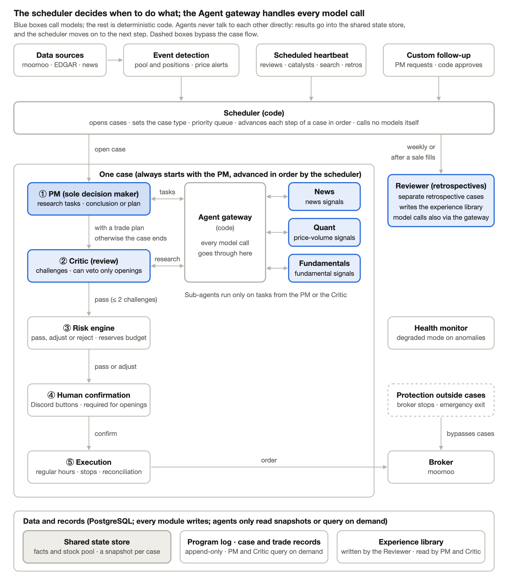

# AI Agent US Stock Trading System Requirements Proposal (Brief)

This document lists only the settled core design. Detailed rules are in the [full version](AI%20Agent%20美股交易系统需求%20Proposal.md), which is kept locally and not in the repository.

A multi-agent US stock trading system driven by a code scheduler. A "case" opens only when a notable event occurs or a check comes due; a PM leads sub-agents to research and reach a conclusion. Trade plans are executed only after Critic review, code risk checks and human confirmation. Every action is logged, to evaluate whether each agent contributes alpha.

## Principles

- Only the PM, sub-agents, Critic and Reviewer call models; triggering, scheduling, risk control and order placement are deterministic code
- The PM is the only decision maker; agents never talk to each other directly and collaborate only through Tasks / Results relayed by the Agent gateway
- The shared state store is the single source of facts for all agents; every agent in a case reads the same snapshot
- Every trade must pass code risk control, and every opening trade needs human confirmation
- Cash account, long only: no shorting, no margin; orders only during regular trading hours

## Architecture

| Module | Type | Responsibility |
| --- | --- | --- |
| Event detection layer | Code | Monitors the stock pool and positions; an event enters the queue only when it crosses a threshold |
| Scheduler | Code | Queue and priorities, decides the case type, advances case stages; makes no trading judgments |
| Agent gateway | Code | Checks rules and budgets, calls models, validates output formats |
| PM | Model | Dispatches research tasks, submits conclusions or trade plans |
| News / Quant / Fundamentals | Model | Sub-agents that interpret news, price and volume, and fundamentals per task, outputting signals in a uniform format |
| Critic | Model | Reviews the PM's trade plans, using a model from a different vendor than the PM |
| Risk engine | Code | Checks plan risk; the result is pass, adjust or reject |
| Execution module | Code | The only module that can place orders; manages orders, stop orders and reconciliation |
| Health monitor | Code | Enters degraded mode when it detects anomalies |
| Reviewer | Model | Weekly retrospectives and a retrospective for each sale, written to the experience library |

## Where cases come from

| Driver | Trigger | Purpose |
| --- | --- | --- |
| Event-driven | Detected in real time by the event detection layer; price conditions use moomoo price alerts | React to external changes such as price moves, news and filings, and earnings |
| Scheduled heartbeat | Checked by code at each trading day's close | Routine checks: review dates and catalyst deadlines coming due, new candidates, and stock search when the pool is short of candidates |
| Custom follow-up | Requested by the PM in a conclusion, approved by code | A one-off check for a specific reason, with the question written by the PM |

The stock pool is the only source of what the system monitors. New stocks are added by hand or by PM stock search, and start as "candidate". A stock's status, not the driver, decides which conclusions a case allows:

| Status | Allowed conclusions |
| --- | --- |
| Holding | Hold, add, reduce, close, update thesis, request follow-up |
| Watch | Opening plan, keep watching, update watch thesis, demote to candidate, remove, request follow-up |
| Candidate | Promote to watch, keep, remove |

Each trigger opens its own case, never merged; only one case runs per stock at a time and the rest queue and run in turn. In the queue, holding cases come first, then watch stocks, then candidates, with stock search and retrospectives last.

## How a case runs

1. The scheduler opens the case, sets the question to answer and the allowed conclusions, and wakes the PM
2. The PM dispatches tasks to sub-agents through the Agent gateway, at most 2 rounds
3. The PM submits a conclusion with a score; most cases end with "no action". Opening and promoting to watch must cite results from at least 2 different sub-agents
4. Trade plans go to the Critic, which can pass, challenge or ask for more research. Opening plans can be vetoed; exit plans cannot, and disagreements go to a human
5. The risk engine checks and reserves budget → recheck with live data before ordering → human confirmation → the execution module places the order

## Holding and exiting

Every investment thesis states the reason to buy, catalysts and their deadlines, target price, invalidation conditions and review date. A position is held as long as its thesis holds, with no fixed-day exit.

| Exit path | Trigger | Human confirmation |
| --- | --- | --- |
| Broker-side stop order | Price hits the stop price | Not needed |
| Emergency risk exit | Code rules, such as a drop past the emergency threshold or the portfolio hitting its circuit breaker | Not needed; notified after execution |
| Model-suggested exit | The PM judges the thesis broken, does not renew at review, or the target price is reached | Needed by default |

## Risk control and execution

- Risk is checked per trade and for the portfolio's total risk. Opening rules limit funds (settled cash only), position size and sector concentration; reducing rules make sure exits are never blocked
- Before submitting an order, live data is read again and risk control runs once more; a plan past its validity or with too large a price deviation is voided
- Cases open as usual before and after market hours; the resulting plans execute at the open
- After a buy fills, a broker-side stop order is placed; client order IDs prevent duplicate submissions; a full reconciliation with the broker runs after each day's close

## Failures and degradation

- Each agent can have one or more backup models, switched to in order when the primary is unavailable; only when all of the PM's or the Critic's models are unavailable does it count as a model API failure
- Failures in the model API, broker connection, data or budget enter degraded mode: stop orders are kept, opening is paused, no new model-initiated exits are made, and an alert is sent
- A system failure is not treated as an investment judgment: when a review comes due but has no conclusion because of a failure, it is postponed
- Emergency risk exits do not depend on models and stay in effect when degraded

## Records and evaluation

- Records have four parts: the program log (every program action in real time), case records (every case opened by the three drivers, including those that called no agent), trade records (like a bank statement: one entry per buy, sell and stop order, with status, fill price, fees, settlement status and source case ID), and the state store (the shared state store). The PM and Critic query them on demand; nothing is injected into context automatically
- Retrospectives: one a week, triggered by the scheduled heartbeat; one after each sale, event-driven for automatic stop-order exits and started automatically when an active exit fills. Results are written to the experience library
- Signals are evaluated by excess return relative to the sector ETF, broken down by agent, model and case type
- Changes to rules, prompts and thresholds are suggested by the Reviewer and take effect only after human confirmation

## Tech stack

| Component | Choice |
| --- | --- |
| Case workflows, queues, scheduled jobs | DBOS |
| Agent calls and data formats | PydanticAI, Pydantic |
| Storage | PostgreSQL |
| Quotes, price alerts and live trading | moomoo OpenAPI + OpenD |
| Filings and earnings reports | SEC EDGAR |
| Models | Flash models for sub-agents; a stronger model for the PM; the Critic from a different vendor than the PM (including backups); each agent can have backup models |
| Notifications and human confirmation | Discord bot |
| Dev tools | uv, Ruff, mypy, pytest, GitHub Actions CI |
| Deployment | One always-on machine, PostgreSQL in Docker |
